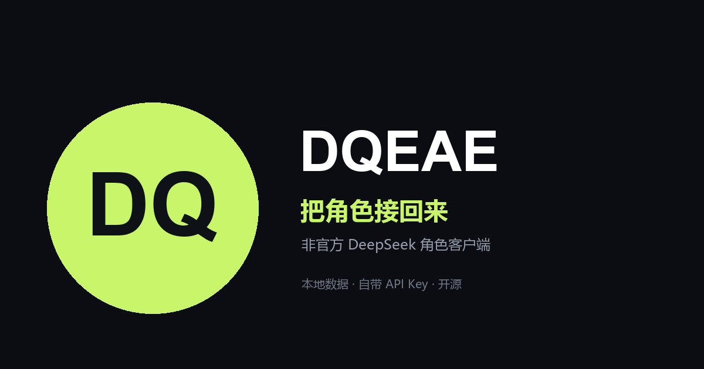

# DQEAE

非官方 DeepSeek 角色客户端。聊天内核基于官方开源的 [chat-demo](https://github.com/deepseek-ai/chat-demo)，外面加了一层保姆级引导：打开网页导出 → 选择 ZIP 自动导入 → 填 API Key。

> **非官方项目**：与 DeepSeek 及其关联公司没有隶属、合作或背书关系。详见 [DISCLAIMER.md](DISCLAIMER.md)。



## 功能

- **官方 UI**：聊天界面直接使用 chat-demo 源码，只加了四个原生钩子，不改视觉；
- **首次引导**：没有历史时引导去网页端导出；没有 ZIP 时打开 `chat.deepseek.com`；没有 Key 时打开开放平台；
- **自动导入**：系统文件选择器选 ZIP → 原生分块传给网页 → 复用官方 `importHistory`；
- **自适应图标**：Android 8+ 自适应图标、Android 13 单色主题图标；
- **本地优先**：会话、Key、背景都在本机，只有聊天时请求你配置的 API。

## 下载

从 [Releases](https://github.com/niumolike/DQEAE/releases) 下载 `DQEAE.apk`（Android 7.0+）。

- 包名 `com.dqeae.app`；
- v2 + v3 签名；
- 首次安装需允许「未知来源」。

## 从源码构建

```bash
# 1. 安装 chat-demo 依赖（首次）
cd chatdemo/app
pnpm install --node-linker=hoisted
cd ../..

# 2. 构建聊天前端
node chatdemo/build.mjs

# 3. 打 APK
node android/build.mjs
```

APK 构建不依赖 Gradle / Android Studio，使用 `aapt2 + javac + d8 + apksigner`。
需要在 `android/toolchain/` 放三样东西：

- `platform-35-ext15/android.jar`（Google `platform-35-ext15_r01.zip`）
- `android-15/`（Google `build-tools_r35_windows.zip`）
- Zulu JRE 17（运行 d8 与 apksigner）

外加本机 JDK 8 的 `javac`。细节见 [android/README.md](android/README.md)。

## 目录

```
chatdemo/app/        chat-demo fork（四个钩子 + 聊天背景）
chatdemo/build.mjs   chat-demo 构建脚本
src/native-shell/    首次启动引导页
android/             WebView 壳、构建链、图标
brand/               封面与图标设计稿
```

## 隐私与条款

- [隐私政策](PRIVACY.md)
- [使用条款](TERMS.md)
- [免责声明](DISCLAIMER.md)
- [第三方组件许可](THIRD_PARTY_NOTICES.md)

## 上游与许可

- 本项目：MIT，见 [LICENSE](LICENSE)；
- 聊天界面来自 chat-demo，Copyright (c) 2026 DeepSeek，MIT，见 [NOTICE](NOTICE) 与 `chatdemo/app/LICENSE`；
- DQEAE 名称、DQ 图标、青柠配色为原创，不使用 DeepSeek 官方标识。

## 路线图

- [ ] 省钱合并：摘要 + 最近 20 轮 + 语气样本
- [ ] 角色卡（Character Card V2 / PNG 导入导出）
- [ ] 长期记忆策略
- [ ] iOS（PWA 先行，原生包需要 macOS）
